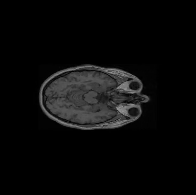
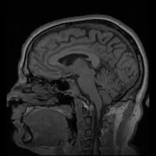
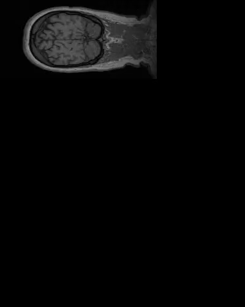
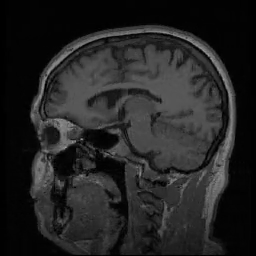
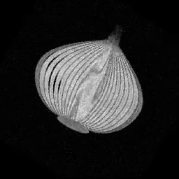
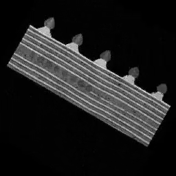
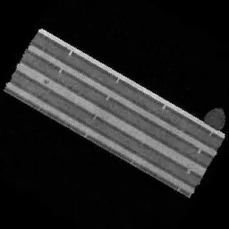
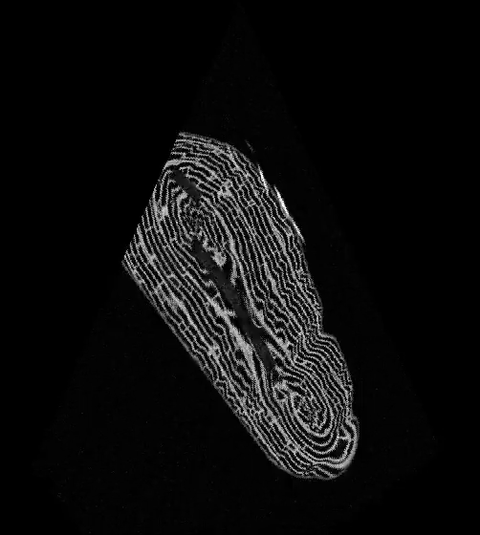

# plane-projection-3d

Ex1 (Introduction to Software Engineering, Ariel University): cuts a 3D volume (NRRD) with the planes listed in a CSV file and writes an mp4 with one frame per plane.

**Problem.** Input: a volume `M[x][y][z]` and a CSV where each row is a plane given by 3 points (an isosceles triangle `a,b,c`) or 4 points (an isosceles trapezoid `a',b,a'',c`). Output: one 2D image `E[y,x]` per row (`floor(Dab)` rows, `ceil(Dbc)` columns), each pixel the nearest voxel, 0 outside the volume. An invalid row gives an error frame (black, with text) and the other frames stay correct.

**In scope:** NRRD input, the two plane types, validation, the video demo, speed of at least 30 FPS (about 100 expected) on a 500^3 volume. **Out of scope:** voxel spacing in mm (indices are used), interpolation, a GUI, other file formats.

## Quick start (Windows PowerShell, Python 3.13)
```
py -m venv .venv
.venv\Scripts\Activate.ps1
pip install -r requirements.txt
python -m pytest
python Ex0.py data/MRHead_1.nrrd data/Ex0.csv out.mp4
```
The demo prints the volume, the number of frames, the errors and the FPS of slicing only (the Numba compile is excluded). For `Ex0.csv` it writes 4 frames and reports 1 error (row 3 is not isosceles).

## Usage
```
python Ex0.py file.nrrd file.csv file.mp4
```
CSV format: a header line, then `n,x1,y1,z1,...` with `n` = 3 or 4 (see `data/Ex0.csv`). Blank lines and lines starting with `#` are skipped; rows are counted without them.
To rebuild the videos of the table below for the lecturer's volumes, which are not in this repo (they come from the course folder): `powershell -ExecutionPolicy Bypass -File scripts\run_examples.ps1 -Drive <folder with the .nrrd files and csv\>`.

## Configuration and environment
Windows 11, Python 3.13.17 (developed and tested there). Packages (unpinned, `requirements.txt`): numpy, pynrrd, imageio, imageio-ffmpeg, Pillow, pytest, numba. ffmpeg comes with `imageio-ffmpeg`. Numba is optional: without it a NumPy version gives identical images, slower. There are no environment variables or config files; the video plays at 30 FPS.

## Tests
`python -m pytest` (279 tests, 18 to 21 s). Strategy and test table: [docs/testing.md](docs/testing.md).

## Structure
- `Ex0.py` - the demo (CLI)
- `src/projection/` - `volume_loader`, `csv_planes`, `geometry` (validation), `slicer*` (Numba, NumPy, slow reference), `video`, `synthetic`
- `tests/` - pytest; `benchmarks/` - speed scripts and results; `scripts/` - data and example generators
- `data/` - `MRHead_1.nrrd` (256x256x130, int16), `ball.nrrd` (300^3, uint16, ball of radius 100), `Ex0.csv` (same content as the lecturer's `lecturer_example.csv`), `ball_rotate.csv`, `mrhead_rotate.csv`, `mrhead_sweep.csv`

## Docs and supplementary material
[SRS](docs/SRS.md) - [algorithm](docs/algorithm.md) - [decisions](docs/decisions.md) - [testing](docs/testing.md) - [data](docs/data.md) - [output](docs/output.md) - [experiment](docs/experiment/README.md) - [benchmarks](benchmarks/benchmarks.md) - [AI usage](AI_USAGE.md)

Speed: requirement 30 FPS, about 100 expected on a 500^3 volume. The FPS column below is slicing only, Numba path, clean runs of 2026-11-06 with CPU below 30%; setup, method and limits are in [docs/experiment/README.md](docs/experiment/README.md). The machine is noisy (a few percent to tens of percent); the history is in [benchmarks](benchmarks/benchmarks.md).

Videos (click a picture to open the mp4; GitHub does not play mp4 inside a README):

| Preview | Volume | CSV | Frames | Errors | FPS |
|---|---|---|---|---|---|
| <a href="docs/experiment/ball_rotate.mp4"></a> | ball | `data/ball_rotate.csv` | 60 | 0 | about 615 |
| <a href="docs/experiment/head_rotate.mp4"></a> | MRHead_1 | `data/mrhead_rotate.csv` | 60 | 0 | 1,080 to 1,140 |
| <a href="docs/experiment/head_sweep.mp4"></a> | MRHead_1 | `data/mrhead_sweep.csv` | 60 | 0 | 580 to 750 |
| <a href="docs/experiment/MRHead_1__lecturer_example.mp4"></a> | MRHead_1 | `data/Ex0.csv` | 4 | 1 (row 3) | n/a (3 slices) |
| <a href="docs/experiment/MRHead_1__head.mp4"></a> | MRHead_1 | lecturer `head.csv` | 280 | 0 | 940 to 957 |
| <a href="docs/experiment/onion__onion.mp4"></a> | onion | lecturer `onion.csv` | 120 | 0 | 1,190 to 1,300 |
| <a href="docs/experiment/swiss_roll__swiss_roll.mp4"></a> | swiss_roll | lecturer `swiss_roll.csv` | 120 | 0 | 1,010 to 1,200 |
| <a href="docs/experiment/biscuit_cake__biscuit_cake.mp4"></a> | biscuit_cake | lecturer `biscuit_cake.csv` | 120 | 0 | 1,160 to 1,330 |
| <a href="docs/experiment/croissant__croissant.mp4"></a> | croissant (500^3) | lecturer `croissant.csv` | 100 | 0 | 304 to 352 |

## Open issues
Not yet confirmed or handled: the 4-point order, the coplanarity threshold and the volume size limit. The list is in the "Open" section of [docs/decisions.md](docs/decisions.md).

## AI use and contact
AI assistance is logged in [AI_USAGE.md](AI_USAGE.md); commits made with it are marked "AI-assisted (Claude)". Author: Gashaw (GitHub: Gashaw-ambaw).
