# Experiment: videos and slicing speed

## Goal
Show that `Ex0.py` writes one correct frame per CSV row for synthetic and for the lecturer's volumes, and that slicing is fast enough: at least 30 FPS required, about 100 FPS expected on a 500^3 volume. Data: [data.md](../data.md).

## Setup
- **Machine:** Intel Core i5-1235U (10 cores, 12 threads), 15.7 GB RAM, Windows 11 Home (build 10.0.26300).
- **Software:** Python 3.13.17, numpy 2.5.4, numba 0.68.1, pynrrd 1.1.3, imageio 2.38.1, imageio-ffmpeg 0.6.0 (ffmpeg 7.1), Pillow 13.0.0. These versions were read from the environment on 2026-11-07; the FPS runs were on 2026-11-06.
- **Date of the FPS runs:** 2026-11-06. **CPU load:** below 30% during the runs (checked by the author before each run; not recorded in a file).
- **Code path:** Numba (the default). Playback of the videos is 30 FPS.

## Method
Our own volumes and CSVs (repo):
```
python Ex0.py data/ball.nrrd data/ball_rotate.csv docs/experiment/ball_rotate.mp4
python Ex0.py data/MRHead_1.nrrd data/mrhead_rotate.csv docs/experiment/head_rotate.mp4
python Ex0.py data/MRHead_1.nrrd data/mrhead_sweep.csv docs/experiment/head_sweep.mp4
```
The lecturer's volumes and CSVs (course folder, see [data.md](../data.md)): `powershell -ExecutionPolicy Bypass -File scripts\run_examples.ps1 -Drive <folder>`, which runs `Ex0.py` on six pairs.

- **FPS** is the line `Slicing: N slices in S s = F FPS (slice_volume calls only)` that `Ex0.py` prints. It counts only the slicing calls: the Numba compile (a warm-up call before the timed loop), the video encoding and the file writing are not in it.
- **Frames, errors and canvas size** were read from the mp4 files and the CSV files with imageio and our own `read_planes` (MEASURED on 2026-11-07).

## Results

Click a picture to open the mp4. The FPS values are the author's numbers, MEASURED on 2026-11-06 (Numba path, slicing only, CPU below 30%); they were **not re-measured** when this document was written, and the individual run outputs are not stored in the repo.

| Preview | Volume | CSV | Frames | Errors | Canvas (rows x cols) | Slicing FPS |
|---|---|---|---|---|---|---|
| <a href="ball_rotate.mp4">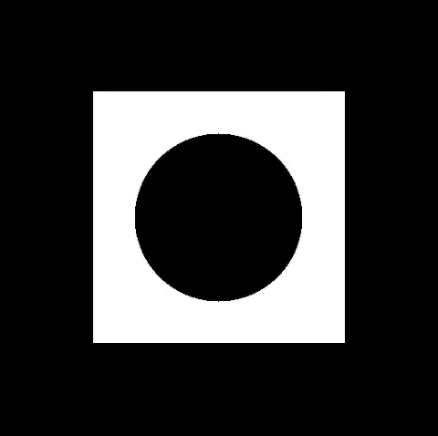</a> | ball | `data/ball_rotate.csv` | 60 | 0 | 520 x 522 | about 615 |
| <a href="head_rotate.mp4">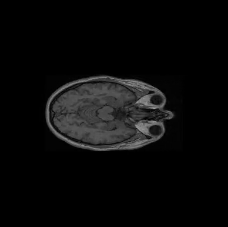</a> | MRHead_1 | `data/mrhead_rotate.csv` | 60 | 0 | 386 x 388 | 1,080 to 1,140 |
| <a href="head_sweep.mp4">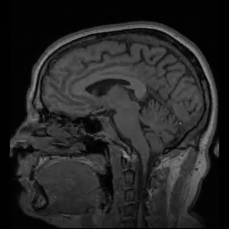</a> | MRHead_1 | `data/mrhead_sweep.csv` | 60 | 0 | 256 x 256 | 580 to 750 |
| <a href="MRHead_1__lecturer_example.mp4">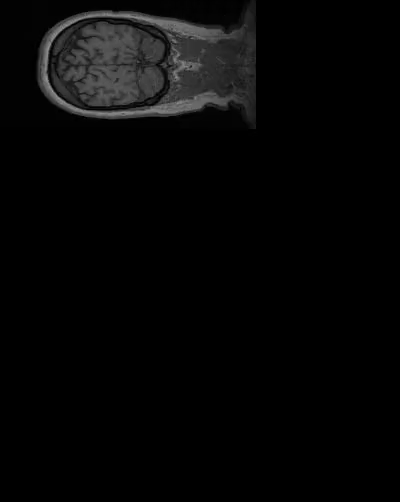</a> | MRHead_1 | `data/Ex0.csv` | 4 | 1 (row 3) | 502 x 400 | n/a (3 slices) |
| <a href="MRHead_1__head.mp4">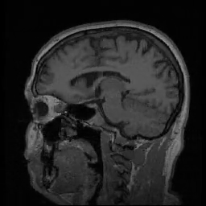</a> | MRHead_1 | lecturer `head.csv` | 280 | 0 | 256 x 256 | 940 to 957 |
| <a href="onion__onion.mp4">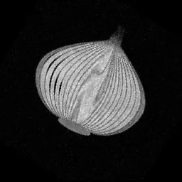</a> | onion | lecturer `onion.csv` | 120 | 0 | 256 x 256 | 1,190 to 1,300 |
| <a href="swiss_roll__swiss_roll.mp4">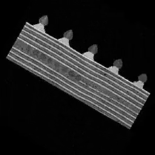</a> | swiss_roll | lecturer `swiss_roll.csv` | 120 | 0 | 256 x 256 | 1,010 to 1,200 |
| <a href="biscuit_cake__biscuit_cake.mp4">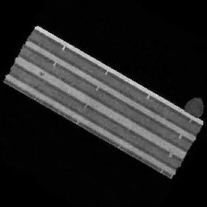</a> | biscuit_cake | lecturer `biscuit_cake.csv` | 120 | 0 | 256 x 256 | 1,160 to 1,330 |
| <a href="croissant__croissant.mp4">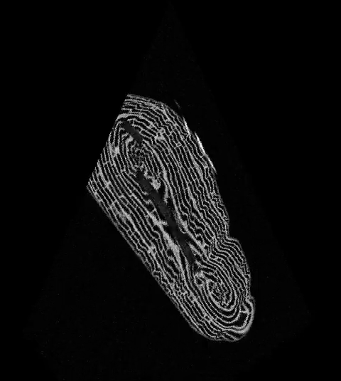</a> | croissant (500^3) | lecturer `croissant.csv` | 100 | 0 | 560 x 502 | 304 to 352 |

## Observations

**Orientation.** Identity (no flip, no rotation) scored highest in all 15 comparisons of our slices against the lecturer's reference panels (axial, coronal, sagittal) for MRHead_1, onion, swiss_roll, biscuit_cake and croissant. The margin over the best other transform is 0.12 to 0.16 on MRHead_1, which is asymmetric and so the strongest evidence; 0.01 to 0.06 on onion, biscuit_cake and croissant, which are nearly symmetric (swiss_roll: 0.04 to 0.16). This was a one-off measurement (masked normalized cross-correlation, searching slice, scale and offset); the scripts were not kept. The reference image of each volume has four panels, not one per CSV row, so the comparison is per panel. In these files a plane of constant z is a sagittal view.

The visible 30 degree tilt in onion, swiss_roll and biscuit_cake comes from the 30 degree in-plane rotation written in the lecturer's CSVs (first plane z = 64.5, a->b at 60, 30 and 90 degrees to x, y and z), not from a rotation in our code.

Our rows 1 to 3 and our best sagittal slice (top), and the four reference panels (bottom):

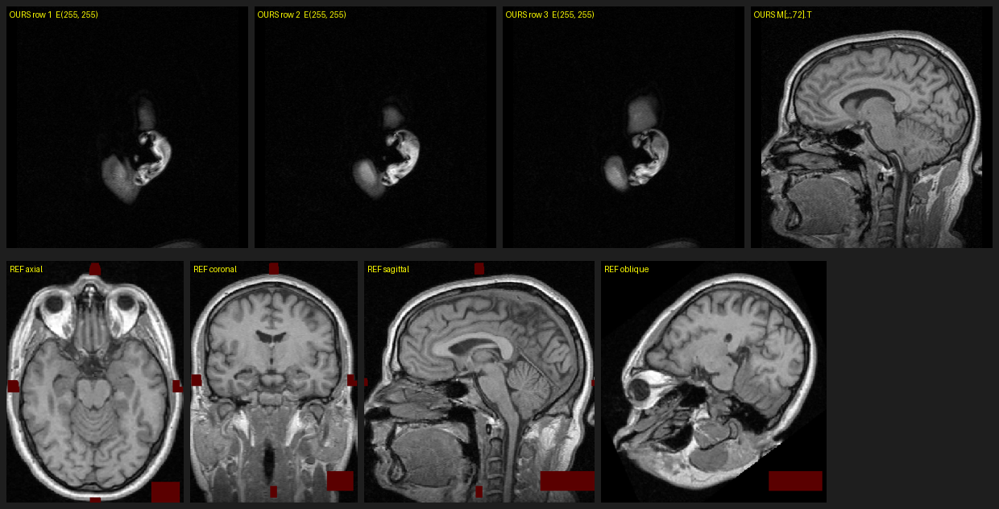

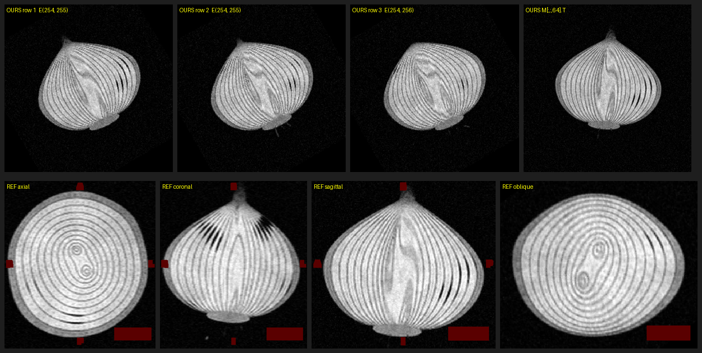

For MRHead_1, rows 1 to 3 of `head.csv` are the slices z = 0 to 2, the very edge of the head, so they show only a small fragment.

## Limits
- The FPS values are slicing only, not end-to-end. Encoding and writing the mp4 are slower; end-to-end `Ex0.py` on the croissant was 58 to 165 FPS (Numba, MEASURED earlier, [benchmarks.md](../../benchmarks/benchmarks.md)).
- The FPS ranges come from repeated runs whose number and raw output were not kept. The machine is noisy: about 10% between runs, and background load changed results by 1.6x or more.
- Correctness of the pictures was judged by eye and, for orientation, by the one-off measurement above; there is no automatic comparison with the lecturer's images.
- The lecturer's volumes are not in the repo, so these runs can only be repeated with the course folder. `edge_cases.csv` has no video here: with the 2048 limit its frame 16 is an error frame.
- Only one machine and one software setup were used.

## Conclusion
- All 9 videos have one frame per CSV row, and only the lecturer's example gives an error frame (row 3, as expected).
- Slicing ran at 304 to 1,330 FPS on the Numba path, above the 30 FPS requirement and above 100 FPS on the 500^3 croissant volume (304 to 352).
- Our slices have the same orientation as the lecturer's reference panels; the 30 degree tilt comes from his CSVs.
